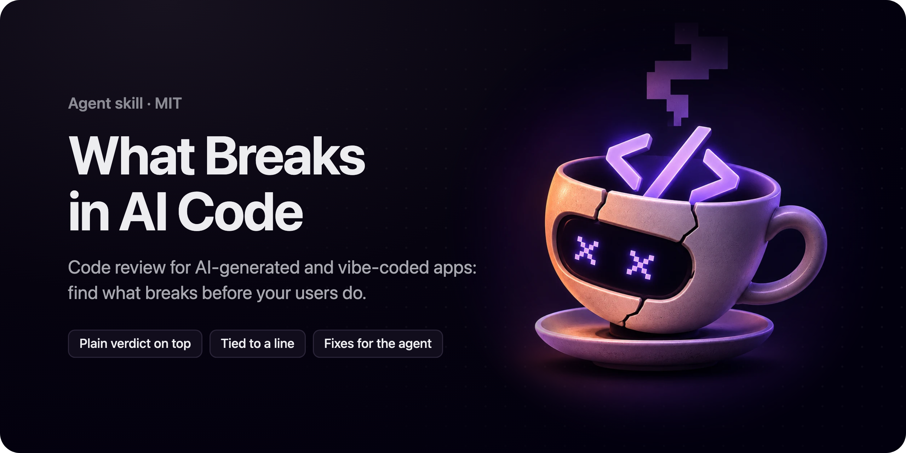

<p align="center">
  
</p>

<h1 align="center">What Breaks in AI Code</h1>

<h3 align="center">Find out what breaks before your users do.</h3>

<p align="center">
  Code review for AI-generated and vibe-coded apps, and for any pull request, your latest changes or the whole app.<br />
  The report opens with a verdict in plain words and what users would see, then every finding with its line, its evidence and a fix.
</p>

<p align="center">
  <a href="#install"></a>
  <a href="#install"></a>
  <a href="#install"></a>
  <a href="#install"></a>
  <a href="CHANGELOG.md"></a>
  <a href="LICENSE"></a>
</p>

<p align="center">
  <a href="#quick-start">Quick start</a> ·
  <a href="#who-its-for">Who it's for</a> ·
  <a href="#the-report">The report</a> ·
  <a href="#what-it-checks">What it checks</a> ·
  <a href="#install">Install</a>
</p>

## Quick start

```bash
npx skills add arez-xd/what-breaks-in-ai-code
```

Then ask your agent:

```text
Review my changes before I push.
```

```text
I built this app with an AI agent and want to launch on Monday. Is it safe to ship?
```

```text
Review PR #42. The author says validation is handled upstream.
```

The [open skills CLI](https://github.com/vercel-labs/skills) installs into Claude Code, Codex, Cursor, GitHub Copilot and other agents; manual setup is under [Install](#install). More requests in [`examples/prompts.md`](examples/prompts.md).

## Why

An AI agent builds an app that works in the demo. What it skipped shows up when real users arrive: a second customer who sees the first one's orders, a double tap that charges twice, a key in the page that anyone can copy, a chatbot reply that runs code in the user's browser, a test that passes whatever the code does.

This skill has the agent review the way the engineer who owns the service would: next to the code around the change, against the codebase's own conventions, with every write played out twice and every test broken on purpose. Then it says, in words anyone can act on, whether to ship and what to fix first.

## Who it's for

- **You built it with an AI agent** and can't read all of the code. Read the verdict, then hand the findings to the agent that wrote the code: each fix names the file, the change and how to check it.
- **You review pull requests.** Every finding carries its file and line, the evidence, a severity set by what breaks, and a fix. Nits are held back unless you ask, so the list stays short.
- **You decide whether it ships:** a founder, a product owner, a lead. The top of the report is written for you.

## What it reviews

It picks the target from your request and the repository, and the report's first line says what it took:

1. what you name: a pull request, a branch, a commit, a diff, some files, or "the whole app";
2. otherwise, your uncommitted changes against the last commit;
3. otherwise, the branch against its base;
4. otherwise, the whole project, read in order of risk: access, money, writes and deletes, input that reaches a query or a file, secrets, jobs and webhooks. Where it stopped goes under "Not reviewed".

## The report

One report in two layers, in your language. The top, for whoever decides:

```
Reviewed: the changes since the last commit, 6 files.
Verdict: Fix first, then ship. The new checkout works for one customer at a time; two things break once real customers arrive.
What users would see:
- A customer who taps Pay twice is charged twice (1).
- Anyone signed in can open other customers' orders by changing the number in the address bar (2).
Can wait: 3, 4.
```

Below it, for whoever fixes, every finding in the same shape:

```
### 1 · [Blocker] A double tap on Pay charges twice
`api/checkout.ts:58` · traced
What: the charge is created before the order is marked paid, with no idempotency key.
Evidence: the refund route sends one (`api/refunds.ts:31`); the payment provider retries on a timeout.
Why it matters: a double tap or a network retry charges the card twice.
Fix: pass the order ID as the idempotency key and mark the order paid in the same transaction. To check: send the request twice in a test and expect one charge.
```

Then the counts, the conventions the change was held to, what it checked and found sound, and what it didn't review.

The verdict is one of three: **ready to ship**; **ship, the rest can wait** (minor issues only); or **fix first**, with "then ship" when every fix is local and "then review again" when a fix changes the design. The top restates the findings and never re-ranks them.

## What it checks

| | Pass | What it looks for |
|---|---|---|
| 1 | **Siblings** | The new route next to its closest existing one: access check, tenant filter, deleted records, validation, limits, errors. A new component next to the one that shows the same content; a helper rewritten next to the original |
| 2 | **Boundaries** | Values that cross files and services: cents or dollars, seconds or milliseconds, UTC or local, whose ID, what a helper returns when nothing is found |
| 3 | **Two requests** | Every write played out twice and at once: double clicks, retries, redelivered webhooks, overlapping jobs, a failure halfway; caches and totals that go stale |
| 4 | **Security** | Injection, HTML from users or a model shown without a sanitizer, access to other people's records, real-time channels anyone can join, input and model output trusted without a check, secret keys in code the browser gets (publishable ones are left alone), open database rules, a session token page scripts can read, webhooks with no signature check, SSRF, path traversal |
| 5 | **Correctness and performance** | Edge cases, unhandled errors, time zones and money, queries in a loop, lists with no limit, paid APIs with no cap per user |
| 6 | **Tests** | Tests that pass whatever the code does: the code under test mocked, assertions never awaited, true by construction; risky paths with no test |
| 7 | **Looks finished** | What AI-written code leaves behind: placeholders and mock data, a check commented out, packages that don't exist or have look-alike names, errors swallowed while the user sees success, features with no code behind them |

After the passes it notes what **could be simpler**: an abstraction with one use, the same logic written twice, a `try`/`catch` around code that can't throw, retries and flags nobody asked for, dead code, deep nesting, comments that restate the line. Each comes with its line and the shorter version. They are counted and held back; ask "what could be simpler?" to see the list. Surplus that hides a failure, such as a swallowed error, is reported as a finding.

Before it reports, it ties each finding to a line and to the code that shows it, runs what it safely can (marked **verified**, otherwise **traced**) and checks what sits upstream. Code that looks risky and is safe in context goes under "Looks good".

## The rules

- **Read-only.** It reads the code and runs only what's already installed: tests, a small script, the type checker. It installs no packages, runs no install scripts and touches no production data or live keys.
- **Every finding is tied to a line,** with its evidence. Guesses like "might be slow" stay out. The same defect in many places is one finding, with a count and a list.
- **Severity follows the failure:** what users or the business would lose, in this deployment.
- **An assurance is a reason to look.** "Validation is handled", "the tests cover it": it checks and says what it found.
- **Secrets are quoted masked:** the first four characters and the length.

## What's inside

```
skills/what-breaks-in-ai-code/
  SKILL.md        what to review, reading the change, seven passes, what could be simpler, verification, severity, fixes, the report
  agents/         metadata for Claude Code and Codex
examples/
  prompts.md      requests for your changes, a pull request and a whole app
```

## Install

**Any agent, with the skills CLI:**

```bash
npx skills add arez-xd/what-breaks-in-ai-code
```

**By hand:** copy `skills/what-breaks-in-ai-code` into the agent's skills folder. Every agent below reads `SKILL.md` natively; no rule files or adapters are needed.

| Agent | One project | All projects |
|---|---|---|
| Claude Code | `.claude/skills/` | `~/.claude/skills/` |
| Codex | | `~/.codex/skills/` |
| Cursor | `.cursor/skills/` (also reads `.claude/skills/`) | `~/.cursor/skills/` |
| GitHub Copilot: VS Code agent mode, Copilot CLI, cloud agent | `.github/skills/` (also reads `.claude/skills/`) | `~/.copilot/skills/` |

The agent picks the skill up when you ask for a review or ask whether code is safe to ship; you can also call it with `/what-breaks-in-ai-code`.

**Requirements:** none beyond the agent. `git` lets it find your latest changes, and the GitHub CLI (`gh`) lets it read a pull request with its description and comments.

## Limitations

- It reads code. What only a running system shows (load, a third party's real responses, the headers and cookie flags a live site sends, settings kept outside the repository) goes under "Not reviewed".
- On a large project it reads the risky areas first and says where it stopped. A review of a whole app is a first pass.
- Severity is judged from the code and your request. If your deployment differs (internal only, a single customer), say so and it ranks for that.
- It knows what your product should do from the request, the description and the code. A rule that lives only in your head can't be checked.

## FAQ

**Do I need to know how to code?**
No. Read the top of the report: the verdict, what users would see, what can wait. Hand the findings to whoever fixes the code, or paste them into the agent that wrote it.

**Will it change my code?**
No. It writes the fixes into the report; ask your agent to apply them afterwards.

**Which languages and frameworks?**
Any the agent can read. The passes follow how code fails (access, units, concurrency, tests), whatever the stack.

**Does it replace a security audit?**
It covers the security problems a reviewer can see in code: injection, HTML from users or a model, access, secrets, the session, input checks, webhooks. Infrastructure, the headers a live site sends, dependencies' own vulnerabilities and penetration testing are outside it.

**Why are nits hidden?**
A review with twenty style notes buries the two that matter. Nits and places that could be simpler are counted and held back; ask "nits too" or "what could be simpler?" to see them.

## Related

- [Blind Test](https://github.com/arez-xd/blind-test): proves whether a skill, a harness or an MCP server helps, with a key written before any run; the [Agensi edition](https://agensi.io/r/ADAMREEL?to=/skills/blind-test) adds a map of what the agent finds without a skill.
- [Product Audit](https://agensi.io/r/ADAMREEL?to=/skills/product-audit): a read-only audit of a product you own, from UX and accessibility to the design system and security.
- [Under the Hood](https://github.com/arez-xd/under-the-hood): check an online service before you pay for it.

## License

MIT © 2026 [Adam Reznik](https://adamreznik.com)
